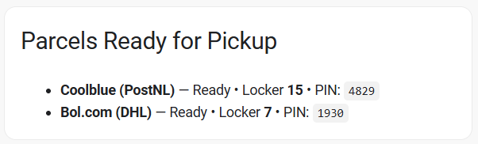
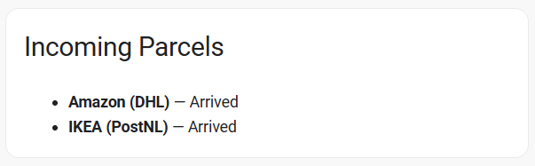
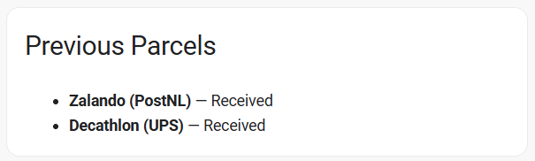
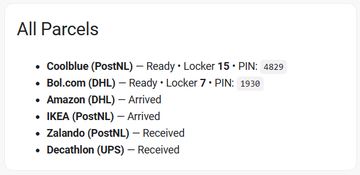
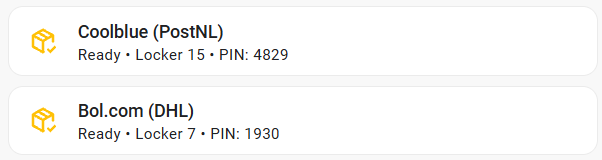
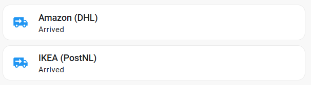
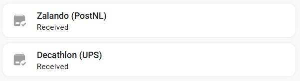
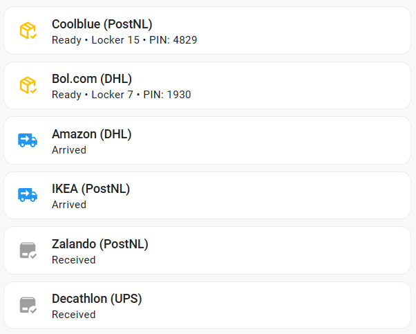

# MyPup Dashboard Examples

Replace `sensor.mypup_my_pickup_point_*` below with your own MyPup sensor entity IDs if your pickup point has a different name.

---

## 1. Basic Home Assistant (Built-in Markdown Card)

Works out of the box on any Home Assistant installation with **no custom frontend cards** required.

### 1.1 Ready for Pickup


```yaml
type: markdown
title: Parcels Ready for Pickup
content: |
  
  
  No MyPup parcels ready for pickup.
  
  
  - **{{ p.description or p.reference_no }}** — Ready • Locker **{{ p.locker }}** • PIN: `{{ p.pin or 'N/A' }}`
  
  
```

### 1.2 Incoming / On Their Way


```yaml
type: markdown
title: Incoming Parcels
content: |
  
  
  No incoming MyPup parcels.
  
  
  - **{{ p.description or p.reference_no }}** — {{ p.state_code }}
  
  
```

### 1.3 Previous Parcels


```yaml
type: markdown
title: Previous Parcels
content: |
  
  
  No previous MyPup parcels.
  
  
  - **{{ p.description or p.reference_no }}** — {{ p.state_code }}
  
  
```

### 1.4 All Parcels


```yaml
type: markdown
title: All Parcels
content: |
  
  
  No MyPup parcels found.
  
  
  
  - **{{ p.description or p.reference_no }}** — Ready • Locker **{{ p.locker }}** • PIN: `{{ p.pin or 'N/A' }}`
  
  - **{{ p.description or p.reference_no }}** — {{ p.state_code }}
  
  
  
```

---

## 2. Streamline Card + Mushroom

Requires [Streamline Card](https://github.com/brunosabot/streamline-card) and [Mushroom](https://github.com/piitaya/lovelace-mushroom) from HACS.

### Step 1: Add templates to Dashboard Raw Configuration
Open **Dashboard → ⋮ → Edit dashboard → ⋮ → Raw configuration editor** and paste this at the top (above `views:`):

```yaml
streamline_templates:
  mypup_ready_parcels:
    default:
      - entity: sensor.mypup_my_pickup_point_parcels_ready_for_pickup
    card:
      type: vertical-stack
      cards_javascript: |
        const parcels = states['[[entity]]']?.attributes?.parcels || [];
        if (!parcels.length) {
          return [{ type: 'markdown', content: 'No MyPup parcels ready for pickup.' }];
        }
        return parcels.map((p) => ({
          type: 'custom:mushroom-template-card',
          primary: p.description || p.reference_no,
          secondary: `Ready • Locker ${p.locker} • PIN: ${p.pin || 'N/A'}`,
          icon: 'mdi:package-variant-closed-check',
          icon_color: 'amber',
          tap_action: {
            action: 'perform-action',
            perform_action: 'mypup.unlock_locker',
            data: { shipment_uid: p.shipment_uid },
            confirmation: { text: `Unlock Locker ${p.locker}?` }
          }
        }));

  mypup_incoming_parcels:
    default:
      - entity: sensor.mypup_my_pickup_point_incoming_parcels
    card:
      type: vertical-stack
      cards_javascript: |
        const parcels = states['[[entity]]']?.attributes?.parcels || [];
        if (!parcels.length) {
          return [{ type: 'markdown', content: 'No incoming MyPup parcels.' }];
        }
        return parcels.map((p) => ({
          type: 'custom:mushroom-template-card',
          primary: p.description || p.reference_no,
          secondary: p.state_code,
          icon: 'mdi:truck-delivery',
          icon_color: 'blue',
          tap_action: { action: 'none' }
        }));

  mypup_previous_parcels:
    default:
      - entity: sensor.mypup_my_pickup_point_previous_parcels
      - max_items: 10
    card:
      type: vertical-stack
      cards_javascript: |
        const parcels = (states['[[entity]]']?.attributes?.parcels || []).slice(0, Number('[[max_items]]') || 10);
        if (!parcels.length) {
          return [{ type: 'markdown', content: 'No previous MyPup parcels.' }];
        }
        return parcels.map((p) => ({
          type: 'custom:mushroom-template-card',
          primary: p.description || p.reference_no,
          secondary: p.state_code,
          icon: 'mdi:package-check',
          icon_color: 'grey',
          tap_action: { action: 'none' }
        }));

  mypup_all_parcels:
    default:
      - entity: sensor.mypup_my_pickup_point_all_parcels
      - max_items: 10
    card:
      type: vertical-stack
      cards_javascript: |
        const all = (states['[[entity]]']?.attributes?.parcels || []).slice(0, Number('[[max_items]]') || 10);
        if (!all.length) {
          return [{ type: 'markdown', content: 'No MyPup parcels found.' }];
        }
        return all.map((p) => {
          const isReady = p.state_code === 'ReadyForPickup';
          const isIncoming = ['Registered', 'Arrived', 'WaitForLocker', 'LockerAssigned'].includes(p.state_code);
          return {
            type: 'custom:mushroom-template-card',
            primary: p.description || p.reference_no,
            secondary: isReady ? `Ready • Locker ${p.locker} • PIN: ${p.pin || 'N/A'}` : p.state_code,
            icon: isReady
              ? 'mdi:package-variant-closed-check'
              : isIncoming
                ? 'mdi:truck-delivery'
                : 'mdi:package-check',
            icon_color: isReady ? 'amber' : isIncoming ? 'blue' : 'grey',
            tap_action: isReady
              ? {
                  action: 'perform-action',
                  perform_action: 'mypup.unlock_locker',
                  data: { shipment_uid: p.shipment_uid },
                  confirmation: { text: `Unlock Locker ${p.locker}?` }
                }
              : { action: 'none' }
          };
        });
```

### Step 2: Add the cards (**Add Card → Manual**)

#### 2.1 Ready for Pickup


```yaml
type: custom:streamline-card
template: mypup_ready_parcels
variables:
  - entity: sensor.mypup_my_pickup_point_parcels_ready_for_pickup
```

#### 2.2 Incoming / On Their Way


```yaml
type: custom:streamline-card
template: mypup_incoming_parcels
variables:
  - entity: sensor.mypup_my_pickup_point_incoming_parcels
```

#### 2.3 Previous Parcels


```yaml
type: custom:streamline-card
template: mypup_previous_parcels
variables:
  - entity: sensor.mypup_my_pickup_point_previous_parcels
  - max_items: 10
```

#### 2.4 All Parcels


```yaml
type: custom:streamline-card
template: mypup_all_parcels
variables:
  - entity: sensor.mypup_my_pickup_point_all_parcels
  - max_items: 10
```
